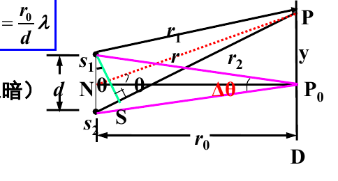
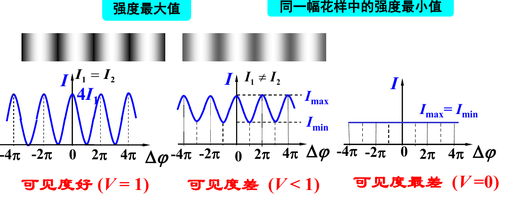
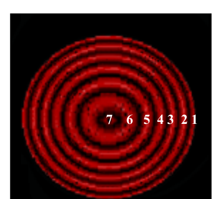
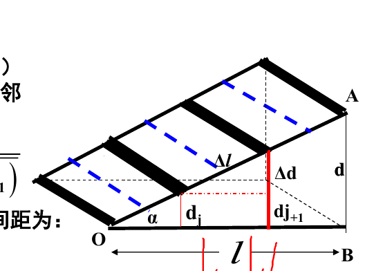

# 第 1 章 光的干涉

这份笔记按《现代光学基础》课件进度逐章整理，全部章节都续写在这一篇里。第 1 章内容包括波动叠加与相干条件、光程与光程差、杨氏双缝干涉、条纹可见度、薄膜等倾干涉与等厚干涉（劈尖）的原理、条纹规律与公式。

## 0 绪论速记

1. **光学的四个分支**：几何光学（直线传播）、波动光学（干涉、衍射、偏振）、量子光学（粒子性）、现代光学（激光、全息、傅里叶光学等）。
2. **光是电磁波**：横波，$\\vec{E} \\perp \\vec{r}$、$\\vec{H} \\perp \\vec{r}$、$\\vec{E} \\perp \\vec{H}$；其中起感光、生理作用的是电场矢量 $\\vec{E}$，称为**光矢量**。
3. **折射率与电磁参量的联系**（光学与电磁学的一座桥）：

$$v = \\frac{c}{\\sqrt{\\varepsilon\_r \\mu\_r}} = \\frac{c}{n} \\quad\\Longrightarrow\\quad n = \\sqrt{\\varepsilon\_r \\mu\_r}$$

对光波 $\\mu\_r \\approx 1$，而 $\\varepsilon\_r$ 随频率变化，所以 $n$ 随频率变化——这就是色散的根源。

4. **可见光范围**：波长 $390 \\sim 760\\ \\mathrm{nm}$，频率 $4.1 \\times 10^{14} \\sim 7.5 \\times 10^{14}\\ \\mathrm{Hz}$，$\\lambda = c/f$；频率与颜色一一对应。
5. **光强**：光强 $I$ 是平均能流密度（坡印廷矢量时间平均），正比于振幅平方。比较相对强度时直接取

$$I = A^2$$

## 1 相干性

### 1.1 波动三性

1. **独立性**：几列波相遇时各自保持原有特性（频率、振幅、振动方向）继续传播，互不影响。
2. **叠加性**：相遇区域内质点的合位移是各波单独引起位移的矢量和（叠加原理成立的前提是波动方程为线性）。
3. **相干性**：两列波叠加后合强度出现稳定的周期性分布（有的地方加强、有的地方减弱），就是干涉。

### 1.2 干涉的充要条件（必记）

1. **频率相同**；
2. **相位差恒定**；
3. **振动方向在同一直线上**（振动面平行）。

满足三条的两光源叫**相干光源**，叠加叫**相干叠加**；否则为非相干叠加，强度直接相加、没有条纹。

干涉是波动的一大特征：凡出现干涉花样的物理过程，一定是波动；光能发生干涉，说明光是一种波动。

### 1.3 为什么普通光源难相干

普通光源是**自发辐射**：同一原子先后发的光、不同原子发的光都彼此独立、随机中断，所以两个独立光源甚至同一发光体的不同部分都不相干。激光是**受激辐射**，频率、相位、振动方向、传播方向全同，天然相干。

**获得相干光的唯一办法**：让到达观察点的两束光来自同一批原子发出的同一列波，再让它们走不同的路：

| 方法 | 原理 | 代表实验 |
| --- | --- | --- |
| 分波面 | 把一个波面切成两部分 | 杨氏双缝 |
| 分振幅 | 一束光在薄膜上下表面反射（或透射）分成两束 | 等倾、等厚干涉 |
| 分振动面 | 把振动面分解后干涉 | 偏振光干涉 |

### 1.4 相干叠加的强度公式

两束相干光在空间某点的合强度：

$$I = A\_1^2 + A\_2^2 + 2 A\_1 A\_2 \\cos\\Delta\\varphi$$

其中 $\\Delta\\varphi$ 是两束光在该点的相位差。$\\Delta\\varphi = 2j\\pi$ 时 $I\_\\max = (A\_1 + A\_2)^2$（相长）；$\\Delta\\varphi = (2j+1)\\pi$ 时 $I\_\\min = (A\_1 - A\_2)^2$（相消）。非相干叠加则只有前两项：$I = A\_1^2 + A\_2^2$。

## 2 光程、光程差与相位差

### 2.1 光程

**定义**：光在介质中走过的几何路程 $r$ 与介质折射率 $n$ 的乘积，$\\Delta = nr$。

物理意义：光程等于光在相同时间内在真空中走过的路程（$\\Delta = nr = \\dfrac{c}{v} \\cdot r = ct$）。引入光程，就是把不同介质中的传播统一折算到真空里比较。

### 2.2 光程差与相位差

两束光的光程差：

$$\\delta = n\_2 r\_2 - n\_1 r\_1$$

相位差与光程差的关系（设两光源初相位差为 $\\varphi\_{02} - \\varphi\_{01}$）：

$$\\Delta\\varphi = \\frac{2\\pi}{\\lambda}\\,\\delta + (\\varphi\_{01} - \\varphi\_{02})$$

对相干光源 $\\varphi\_{02} - \\varphi\_{01}$ 为常量；若初相位相同，则 $\\Delta\\varphi = \\dfrac{2\\pi}{\\lambda}\\delta$，相位差完全由光程差决定。

### 2.3 干涉公式（判明暗的总开关）

$$\\delta = \\begin{cases} j\\lambda, & \\text{干涉相长（明）},\\ I = I\_\\max \\ (2j+1)\\dfrac{\\lambda}{2}, & \\text{干涉相消（暗）},\\ I = I\_\\min \\end{cases} \\qquad (j = 0, \\pm1, \\pm2, \\cdots)$$

$j$ 称为**干涉级**。注意：**第 $m$ 条条纹对应的干涉级是 $j = m - 1$**（从中央数起容易错一位）。

空间中 $\\delta$ 相同的点构成同一级条纹；两点光源的干涉花样是以 $S\_1 S\_2$ 为轴、$S\_1$、$S\_2$ 为焦点的双叶旋转双曲面簇。

## 3 杨氏双缝干涉（分波面）

### 3.1 实验原理

单色光照亮单缝 $S$，$S$ 作为点光源照亮同一波面上的双缝 $S\_1$、$S\_2$（缝距 $d$）。$S\_1$、$S\_2$ 来自同一光源、同一波面，频率相同、相位关系确定、振动方向基本相同（傍轴远场），是标准的相干光源。两束光在距双缝 $r\_0$（即图中 $D$）的屏上叠加成条纹。

### 3.2 条纹公式

屏上条纹位置（以中央 $P\_0$ 为原点）：

$$y = \\frac{r\_0}{d} \\cdot \\begin{cases} j\\lambda, & \\text{明纹} \\ (2j+1)\\dfrac{\\lambda}{2}, & \\text{暗纹} \\end{cases} \\qquad (j = 0, \\pm1, \\pm2, \\cdots)$$

**条纹间距**（相邻明纹或相邻暗纹之间，与 $j$ 无关）：

$$\\Delta y = \\frac{r\_0}{d}\\,\\lambda, \\qquad \\Delta\\theta \\cdot \\Delta y = \\lambda$$

其中 $\\Delta\\theta = d/r\_0$ 是两缝对屏中心的张角。

### 3.3 条纹特征

1. 一组**等间距**、明暗相间的**直条纹**，各级亮纹强度相等，对称分布在中央亮纹两侧；
2. $\\lambda$ 一定时，$\\Delta y \\propto r\_0$、$\\Delta y \\propto 1/d$；$r\_0$、$d$ 一定时，$\\Delta y \\propto \\lambda$——历史上第一次测出光波波长就是靠测 $\\Delta y$ 反推；
3. **白光入射**：只有 $j = 0$ 的中央条纹是白色，其余各级都是彩色，且**内紫外红**（紫光偏折小、靠内）；
4. 等振幅时屏上强度分布 $I = 4A^2 \\cos^2\\dfrac{\\Delta\\varphi}{2}$——条纹强度本质上记录的是相位差的空间分布；
5. 若两光源初相位不同但差值恒定，花样整体平移，移动量由初相位差的大小和正负决定；
6. 干涉把不易观测的波长 $\\lambda$（光波的空间周期性）转化、放大为可直接测量的条纹间距 $\\Delta y$。

## 4 条纹可见度

### 4.1 定义与公式

$$V = \\frac{I\_\\max - I\_\\min}{I\_\\max + I\_\\min}$$

$V$ 也叫对比度或反衬度。用它改写双光束干涉强度分布（$I\_0 = A\_1^2 + A\_2^2$）：

$$I = I\_0\\left(1 + V\\cos\\Delta\\varphi\\right), \\qquad V = \\frac{2 A\_1 A\_2}{A\_1^2 + A\_2^2}$$

### 4.2 三种典型情况

1. $I\_\\min = 0$（两束等强）时 $V = 1$，反差最大，条纹最清晰；
2. $I\_\\max = I\_\\min$ 时 $V = 0$，无条纹，不可辨认；
3. $V$ 由三个因素决定：两束光的**相对强度**、**光源大小**、光源的**单色性**。

> **注：** $V$ 是相干叠加的判据——$V$ 大说明相干性好，$V$ 小则趋于非相干叠加。

## 5 薄膜干涉总论：光程差与半波损失

等倾、等厚都是分振幅薄膜干涉，共用同一套光程差公式。

点光源照射厚度 $d\_0$ 的均匀薄膜（膜折射率 $n\_2$，环境折射率 $n\_1$），上表面反射光与下表面反射再出射的光叠加。两束反射光的光程差：

$$\\delta = 2 d\_0 \\sqrt{n\_2^2 - n\_1^2 \\sin^2 i\_1} - \\frac{\\lambda}{2} = 2 n\_2 d\_0 \\cos i\_2 - \\frac{\\lambda}{2}$$

其中 $i\_1$ 是入射角、$i\_2$ 是折射角。

### 5.1 半波损失（最容易丢的 λ/2）

光从**光疏介质射向光密介质**（$n$ 小 → $n$ 大）反射时，相位突变 $\\pi$，相当于多走（或少走）$\\lambda/2$；从光密射向光疏反射时没有。本章结构里薄膜两侧同为 $n\_1$：两束反射光恰好一束有半波损失、一束没有，所以**两束反射光之间始终存在 $\\lambda/2$ 的额外程差**，与 $n\_1 < n\_2$ 还是 $n\_1 > n\_2$ 无关。

### 5.2 明暗口径（本课件约定）

课件取额外程差为 $-\\lambda/2$，于是由 $\\delta = 2 n\_2 d\_0 \\cos i\_2 - \\dfrac{\\lambda}{2}$ 得：

$$2 n\_2 d\_0 \\cos i\_2 = \\begin{cases} (2j+1)\\dfrac{\\lambda}{2}, & \\text{相长（明）} \\ 2j \\cdot \\dfrac{\\lambda}{2} = j\\lambda, & \\text{相消（暗）} \\end{cases} \\qquad (j = 0, 1, 2, \\cdots)$$

> **注：** 若教材取额外程差为 $+\\lambda/2$，明暗条件正好互换、$j$ 的起点也随之平移。做题先认口径，再套公式——这是本章第一大丢分点。

## 6 等倾干涉（分振幅一）

### 6.1 原理

平行平面薄膜（厚度均匀）＋面光源。面光源上每一点发出的光经薄膜两表面反射后，由透镜会聚到焦平面上一点；**入射角 $i\_1$ 相同**的光束具有相同的光程差、相同的强度，连起来构成同一级条纹。

**定义**：由倾角（入射角）相同的一组光束形成同一级条纹的薄膜干涉，称为等倾干涉。

### 6.2 条纹规律

1. **形状**：透镜焦平面上一组明暗相间的**同心圆环**；
2. **干涉级内高外低**：$i\_2 \\uparrow \\Rightarrow \\cos i\_2 \\downarrow \\Rightarrow j \\downarrow$；中心处 $i\_1 = i\_2 = 0$，$\\delta$ 最大、级次最高，但中心**一般不是零级条纹**（$\\delta$ 里还含 $-\\lambda/2$）；
3. **间距内疏外密**：相邻环的角间距近似

$$\\Delta i \\approx \\frac{\\lambda}{2 n\_2 d\_0\\, i\_2'}$$

离中心越远 $i\_2'$ 越大、$\\Delta i$ 越小；膜越厚 $d\_0$ 越大、环越密，厚到一定程度就看不清；

4. **随膜厚变化**：$d\_0$ 增大，条纹从中心一圈圈**冒出**并向外扩张；$d\_0$ 减小，条纹向中心收缩、湮没。当 $2 n\_2 d\_0$ 改变一个 $\\lambda$（即 $d\_0$ 改变 $\\dfrac{\\lambda}{2 n\_2}$）时，中心恰好冒出或消失一个条纹——数冒环数可以测微小长度变化；
5. **定域**：条纹定域于**无穷远**（实际用透镜把无穷远拉回到焦平面观察，不是跑到无穷远去看）；
6. 透射光也能形成等倾条纹，但第一次透射光远强于后续透射光，可见度很低；激光光源要先扩束成扩展光源再用。

## 7 等厚干涉 · 劈尖（分振幅二）

### 7.1 原理

两表面成微小夹角 $\\alpha$ 的薄膜（劈尖）。入射角一定时，光程差只由入射点处的膜厚 $d\_0$ 决定，**厚度相同的点构成同一级条纹**——这就是等厚干涉。

### 7.2 条纹规律

1. **形状**：一组平行于棱的、明暗相间的**等间距直条纹**；
2. **棱处是暗纹**：$d\_0 = 0$ 对应 $j = 0$ 级暗纹（半波损失在，$\\delta = -\\lambda/2$ 恰好相消）；
3. **级随厚走（高高低低）**：$d\_0$ 越大 $j$ 越高；
4. **相邻条纹的高度差**（与 $j$ 无关）：

$$\\Delta d = \\frac{\\lambda}{2\\sqrt{n\_2^2 - n\_1^2 \\sin^2 i\_1}}$$

条纹间距

$$\\Delta l = \\frac{\\Delta d}{\\sin\\alpha} \\approx \\frac{\\Delta d}{\\alpha}$$

**正射空气劈尖**（$n\_2 = 1$、$i\_2 = 0$）的常用特例：$\\Delta d = \\dfrac{\\lambda}{2}$，$\\Delta l = \\dfrac{\\lambda}{2\\alpha}$（$\\alpha$ 用弧度）；

5. **测微小厚度变化**：把一面下移，条纹向棱方向移动，下移 $\\lambda/2$ 恰好移过一个条纹；厚度改变 $\\Delta d$ 时若 $N$ 个条纹移过某参考点，则

$$\\Delta d = N \\cdot \\frac{\\lambda}{2}$$

6. **定域**：条纹定域于**薄膜表面**；
7. 用扩展光源时，各点产生的条纹组互不相干、强度直接相加，条纹会弯曲、可见度下降；
8. **白光入射**会出现薄层色：不同波长在同一厚度处对不同级次相长，膜面呈彩色——肥皂泡、油膜的颜色就是这么来的。

## 8 等倾 vs 等厚

| 项目 | 等倾干涉 | 等厚干涉 |
| --- | --- | --- |
| 薄膜 | 厚度均匀的平行平面膜 | 厚度不均（劈尖） |
| 光源 | 面（扩展）光源 | 点光源 |
| 条纹由什么决定 | 入射角 $i\_1$ 相同 → 同一级 | 厚度 $d\_0$ 相同 → 同一级 |
| 条纹形状 | 同心圆环，内疏外密 | 平行于棱的直条纹，等间距 |
| 干涉级分布 | 内高外低（中心最高） | 厚处高、薄处低（高高低低） |
| 条纹定域 | 无穷远（透镜焦平面） | 薄膜表面 |
| 观察方式 | 透镜会聚到焦平面 | 直接在膜面附近观察 |

## 9 公式表

| 主题 | 公式 | 备注 |
| --- | --- | --- |
| 折射率 | $n = \\sqrt{\\varepsilon\_r \\mu\_r}$，$v = c/n$ | $\\mu\_r \\approx 1$ |
| 光强 | $I \\propto A^2$，相对强度 $I = A^2$ | — |
| 相干叠加强度 | $I = A\_1^2 + A\_2^2 + 2 A\_1 A\_2 \\cos\\Delta\\varphi$ | 非相干时去掉第三项 |
| 光程 | $\\Delta = nr$ | 等于真空中等时路程 |
| 光程差 | $\\delta = n\_2 r\_2 - n\_1 r\_1$ | 一切干涉先算它 |
| 相位差 | $\\Delta\\varphi = \\dfrac{2\\pi}{\\lambda}\\delta$ | 初相位相同的前提 |
| 明暗条件 | $\\delta = j\\lambda$ 明；$\\delta = (2j+1)\\dfrac{\\lambda}{2}$ 暗 | $j = 0, \\pm1, \\cdots$ |
| 杨氏条纹位置 | $y = \\dfrac{r\_0}{d} j\\lambda$（明） | 暗纹用 $(2j+1)\\lambda/2$ |
| 杨氏条纹间距 | $\\Delta y = \\dfrac{r\_0}{d}\\lambda$ | 与 $j$ 无关 |
| 可见度 | $V = \\dfrac{I\_\\max - I\_\\min}{I\_\\max + I\_\\min} = \\dfrac{2 A\_1 A\_2}{A\_1^2 + A\_2^2}$ | 等强时 $V = 1$ |
| 含可见度的强度 | $I = I\_0(1 + V\\cos\\Delta\\varphi)$ | $I\_0 = A\_1^2 + A\_2^2$ |
| 薄膜光程差（反射） | $\\delta = 2 d\_0 \\sqrt{n\_2^2 - n\_1^2 \\sin^2 i\_1} - \\dfrac{\\lambda}{2} = 2 n\_2 d\_0 \\cos i\_2 - \\dfrac{\\lambda}{2}$ | 含半波损失 |
| 薄膜明暗（本课件口径） | $2 n\_2 d\_0 \\cos i\_2 = (2j+1)\\dfrac{\\lambda}{2}$ 明；$= j\\lambda$ 暗 | $j = 0, 1, 2, \\cdots$ |
| 等倾环间距 | $\\Delta i \\approx \\dfrac{\\lambda}{2 n\_2 d\_0\\, i\_2'}$ | 内疏外密 |
| 等倾冒环 | $d\_0$ 改变 $\\dfrac{\\lambda}{2 n\_2}$ → 中心冒/没一个环 | 测微小位移 |
| 劈尖条纹高度差 | $\\Delta d = \\dfrac{\\lambda}{2\\sqrt{n\_2^2 - n\_1^2 \\sin^2 i\_1}}$ | 正射空气劈尖 $= \\lambda/2$ |
| 劈尖条纹间距 | $\\Delta l = \\dfrac{\\Delta d}{\\alpha}$ | $\\alpha$ 用弧度 |
| 劈尖数条纹测厚 | $\\Delta d = N \\cdot \\dfrac{\\lambda}{2}$ | $N$ 为移过条纹数 |

## 10 易错点清单

1. **第 $m$ 条 ≠ 第 $m$ 级**：从中央数第 $m$ 条条纹对应干涉级 $j = m - 1$。
2. **半波损失别乱加**：只有光疏 → 光密的反射才有；本章薄膜（两侧同介质）两反射光之间净差 $\\lambda/2$，透射光之间没有这个额外程差。
3. **明暗口径先确认**：额外程差取 $-\\lambda/2$ 还是 $+\\lambda/2$，明暗条件整体互换；课件与教材不一致时以题目所用教材为准。
4. **等倾中心不是零级**：中心级次最高，但因 $\\delta$ 含 $-\\lambda/2$，中心一般不是整数级、也不一定最亮。
5. **$j$ 不能取负**：薄膜干涉里 $2 n\_2 d\_0 \\cos i\_2 \\geq 0$，由干涉公式解出的 $j$ 必须 $\\geq 0$，负值舍去。
6. **白光条纹记反**：杨氏白光条纹中央白、两侧彩色且**内紫外红**；不要记成内红外紫。
7. **角度单位**：$\\Delta l = \\Delta d / \\alpha$、等倾环间距公式里的角度一律用**弧度**。
8. **可见度不是清晰度的全部**：$V$ 还受光源大小和单色性影响，两束等强也救不了非单色光源的高级次条纹。
9. **等倾的 $\\Delta i$ 里是 $i\_2'$**（相邻两环折射角的平均值附近取值），别误用入射角直接套。
10. **劈尖棱处是暗纹**：$d\_0 = 0$、$j = 0$ 是暗纹不是亮纹，这是判断半波损失存在与否的经典证据题。

下次课内容：§1.8 迈克尔孙干涉仪、§1.9 法布里–珀罗干涉仪与多光束干涉、§1.10 干涉现象的应用与牛顿环。

---

参考：课件《第 1 章 光的干涉》（现代光学基础课程）；教材《物理光学与应用光学》（石顺祥等）、《新概念物理教程·光学》（赵凯华）。