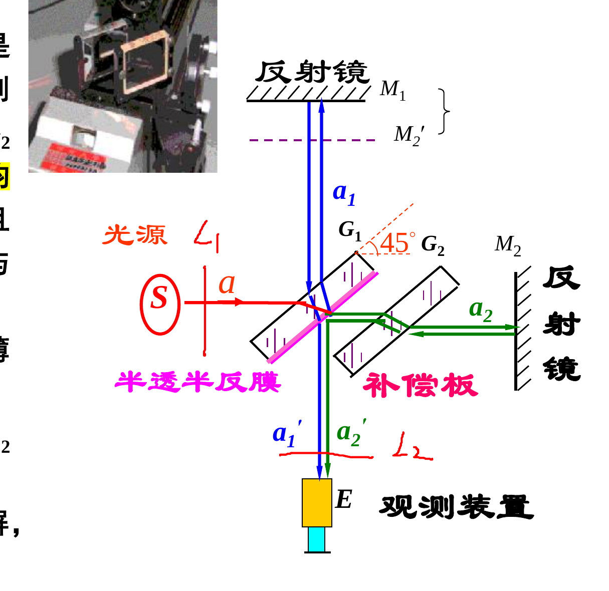
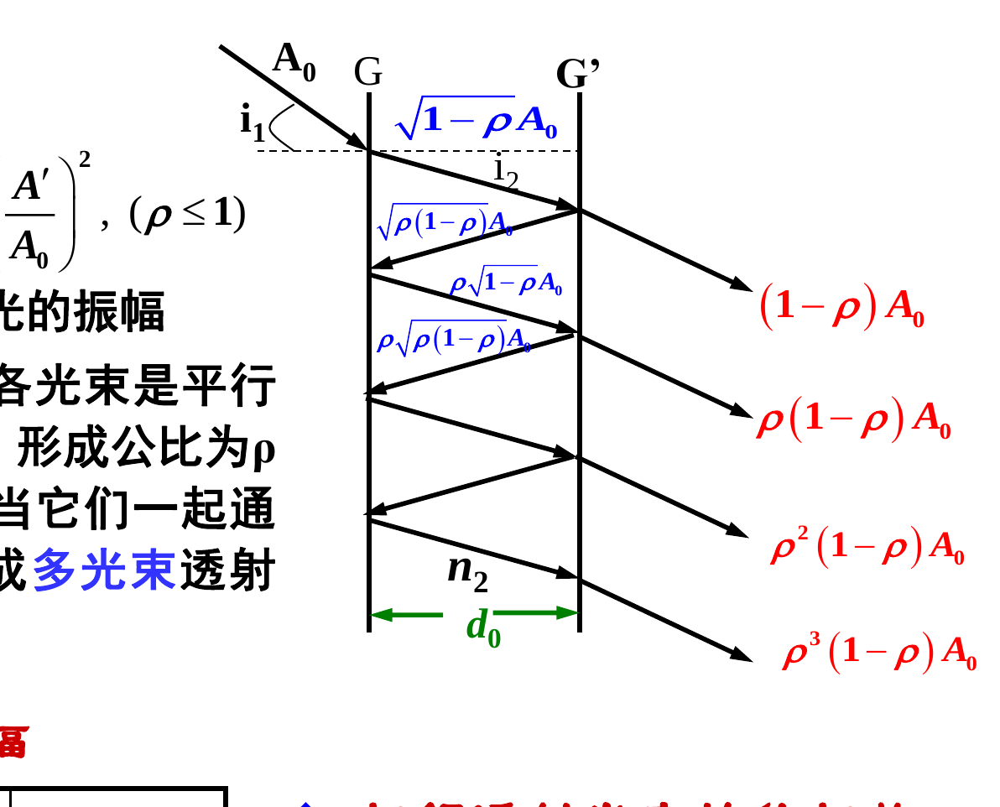
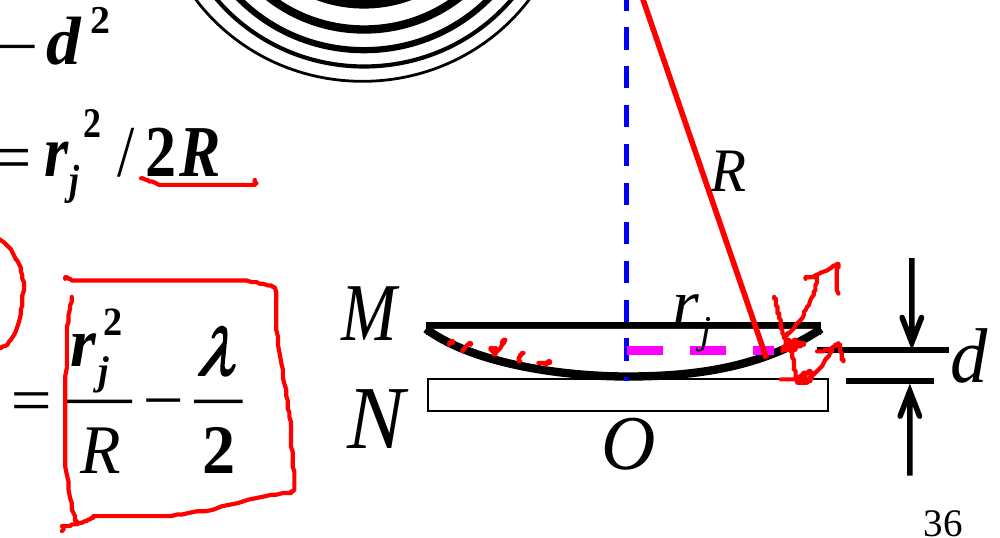
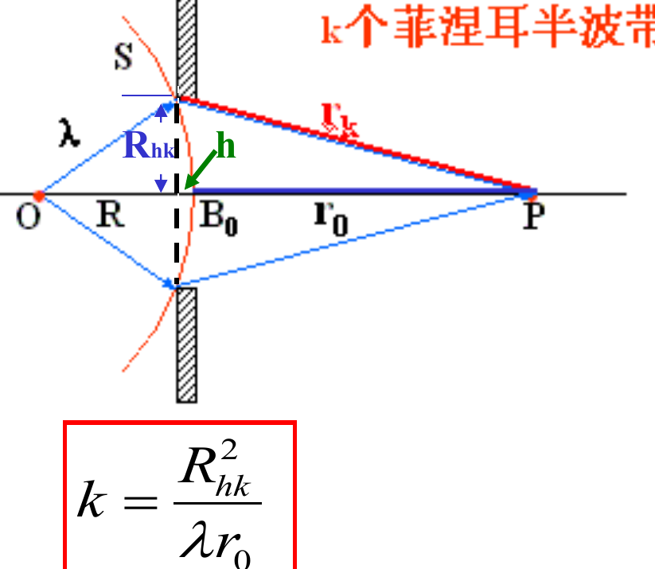
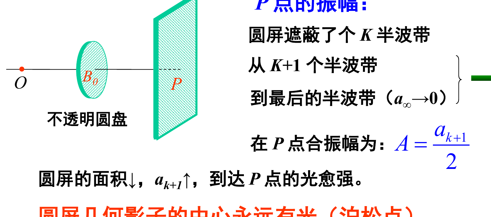
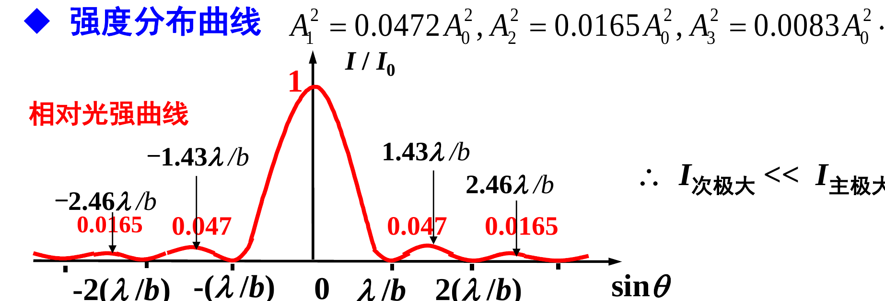
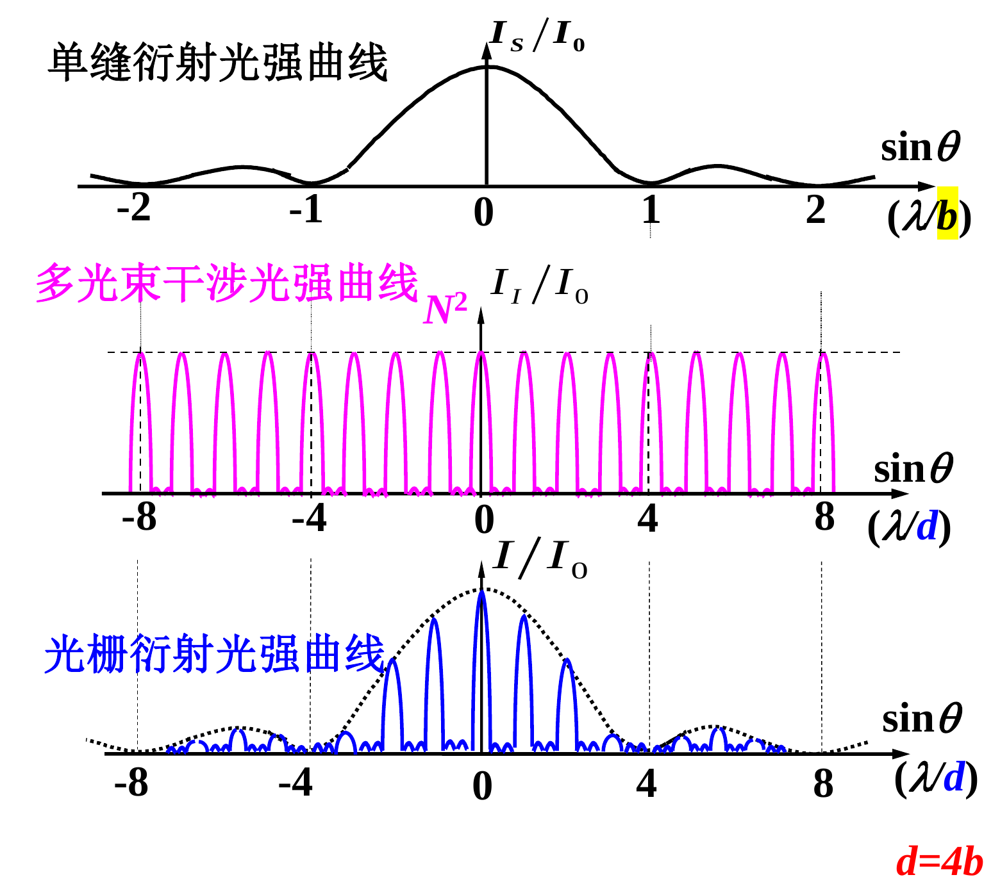
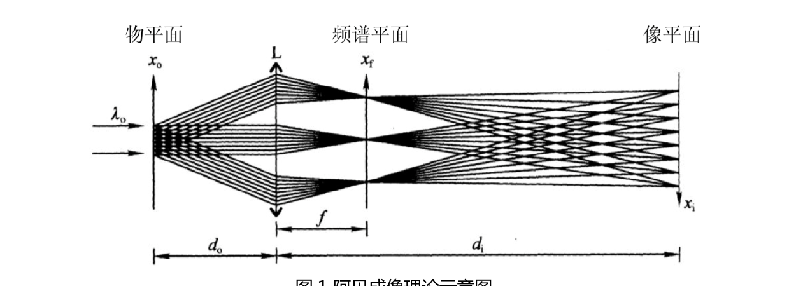

# 第 1 章 光的干涉

这份笔记按《现代光学基础》课件进度逐章整理，全部章节都续写在这一篇里。第 1 章内容包括波动叠加与相干条件、光程与光程差、杨氏双缝干涉、条纹可见度、薄膜等倾干涉与等厚干涉（劈尖）、迈克尔逊干涉仪、法布里–珀罗干涉仪与多光束干涉、干涉现象的应用与牛顿环的原理、条纹规律与公式。

## 0 绪论速记

1. **光学的四个分支**：几何光学（直线传播）、波动光学（干涉、衍射、偏振）、量子光学（粒子性）、现代光学（激光、全息、傅里叶光学等）。
2. **光是电磁波**：横波，$\vec{E} \perp \vec{r}$、$\vec{H} \perp \vec{r}$、$\vec{E} \perp \vec{H}$；其中起感光、生理作用的是电场矢量 $\vec{E}$，称为**光矢量**。
3. **折射率与电磁参量的联系**（光学与电磁学的一座桥）：

$$
v = \frac{c}{\sqrt{\varepsilon_r \mu_r}} = \frac{c}{n} \quad\Longrightarrow\quad n = \sqrt{\varepsilon_r \mu_r}
$$

对光波 $\mu_r \approx 1$，而 $\varepsilon_r$ 随频率变化，所以 $n$ 随频率变化——这就是色散的根源。

4. **可见光范围**：波长 $390 \sim 760\ \mathrm{nm}$，频率 $4.1 \times 10^{14} \sim 7.5 \times 10^{14}\ \mathrm{Hz}$，$\lambda = c/f$；频率与颜色一一对应。
5. **光强**：光强 $I$ 是平均能流密度（坡印廷矢量时间平均），正比于振幅平方。比较相对强度时直接取

$$
I = A^2
$$

## 1 相干性

### 1.1 波动三性

1. **独立性**：几列波相遇时各自保持原有特性（频率、振幅、振动方向）继续传播，互不影响。
2. **叠加性**：相遇区域内质点的合位移是各波单独引起位移的矢量和（叠加原理成立的前提是波动方程为线性）。
3. **相干性**：两列波叠加后合强度出现稳定的周期性分布（有的地方加强、有的地方减弱），就是干涉。

### 1.2 干涉的充要条件

1. **频率相同**；
2. **相位差恒定**；
3. **振动方向在同一直线上**（振动面平行）。

满足三条的两光源叫**相干光源**，叠加叫**相干叠加**；否则为非相干叠加，强度直接相加、没有条纹。

干涉是波动的一大特征：凡出现干涉花样的物理过程，一定是波动；光能发生干涉，说明光是一种波动。

### 1.3 为什么普通光源难相干

普通光源是**自发辐射**：同一原子先后发的光、不同原子发的光都彼此独立、随机中断，所以两个独立光源甚至同一发光体的不同部分都不相干。激光是**受激辐射**，频率、相位、振动方向、传播方向全同，天然相干。

**获得相干光的唯一办法**：让到达观察点的两束光来自同一批原子发出的同一列波，再让它们走不同的路：

| 方法 | 原理 | 代表实验 |
| --- | --- | --- |
| 分波面 | 把一个波面切成两部分 | 杨氏双缝 |
| 分振幅 | 一束光在薄膜上下表面反射（或透射）分成两束 | 等倾、等厚干涉 |
| 分振动面 | 把振动面分解后干涉 | 偏振光干涉 |

### 1.4 相干叠加的强度公式

两束相干光在空间某点的合强度：

$$
I = A_1^2 + A_2^2 + 2 A_1 A_2 \cos\Delta\varphi
$$

其中 $\Delta\varphi$ 是两束光在该点的相位差。$\Delta\varphi = 2j\pi$ 时 $I_{\max} = (A_1 + A_2)^2$（相长）；$\Delta\varphi = (2j+1)\pi$ 时 $I_{\min} = (A_1 - A_2)^2$（相消）。非相干叠加则只有前两项：$I = A_1^2 + A_2^2$。

## 2 光程、光程差与相位差

### 2.1 光程

**定义**：光在介质中走过的几何路程 $r$ 与介质折射率 $n$ 的乘积，$\Delta = nr$。

物理意义：光程等于光在相同时间内在真空中走过的路程（$\Delta = nr = \dfrac{c}{v} \cdot r = ct$）。引入光程，就是把不同介质中的传播统一折算到真空里比较。

### 2.2 光程差与相位差

两束光的光程差：

$$
\delta = n_2 r_2 - n_1 r_1
$$

相位差与光程差的关系（设两光源初相位差为 $\varphi_{02} - \varphi_{01}$）：

$$
\Delta\varphi = \frac{2\pi}{\lambda}\,\delta + (\varphi_{01} - \varphi_{02})
$$

对相干光源 $\varphi_{02} - \varphi_{01}$ 为常量；若初相位相同，则 $\Delta\varphi = \dfrac{2\pi}{\lambda}\delta$，相位差完全由光程差决定。

### 2.3 干涉公式

$$
\delta = \begin{cases} j\lambda, & \text{干涉相长（明）},\ I = I_{\max} \\ (2j+1)\dfrac{\lambda}{2}, & \text{干涉相消（暗）},\ I = I_{\min} \end{cases} \qquad (j = 0, \pm1, \pm2, \cdots)
$$

$j$ 称为**干涉级**。注意：**第 $m$ 条条纹对应的干涉级是 $j = m - 1$**（从中央数起容易错一位）。

空间中 $\delta$ 相同的点构成同一级条纹；两点光源的干涉花样是以 $S_1 S_2$ 为轴、$S_1$、$S_2$ 为焦点的双叶旋转双曲面簇。

## 3 杨氏双缝干涉（分波面）

### 3.1 实验原理

单色光照亮单缝 $S$，$S$ 作为点光源照亮同一波面上的双缝 $S_1$、$S_2$（缝距 $d$）。$S_1$、$S_2$ 来自同一光源、同一波面，频率相同、相位关系确定、振动方向基本相同（傍轴远场），是标准的相干光源。两束光在距双缝 $r_0$（即图中 $D$）的屏上叠加成条纹。

### 3.2 条纹公式

屏上条纹位置（以中央 $P_0$ 为原点）：

$$
y = \frac{r_0}{d} \cdot \begin{cases} j\lambda, & \text{明纹} \\ (2j+1)\dfrac{\lambda}{2}, & \text{暗纹} \end{cases} \qquad (j = 0, \pm1, \pm2, \cdots)
$$

**条纹间距**（相邻明纹或相邻暗纹之间，与 $j$ 无关）：

$$
\Delta y = \frac{r_0}{d}\,\lambda, \qquad \Delta\theta \cdot \Delta y = \lambda
$$

其中 $\Delta\theta = d/r_0$ 是两缝对屏中心的张角。

### 3.3 条纹特征

1. 一组**等间距**、明暗相间的**直条纹**，各级亮纹强度相等，对称分布在中央亮纹两侧；
2. $\lambda$ 一定时，$\Delta y \propto r_0$、$\Delta y \propto 1/d$；$r_0$、$d$ 一定时，$\Delta y \propto \lambda$——历史上第一次测出光波波长就是靠测 $\Delta y$ 反推；
3. **白光入射**：只有 $j = 0$ 的中央条纹是白色，其余各级都是彩色，且**内紫外红**（紫光偏折小、靠内）；
4. 等振幅时屏上强度分布 $I = 4A^2 \cos^2\dfrac{\Delta\varphi}{2}$——条纹强度本质上记录的是相位差的空间分布；
5. 若两光源初相位不同但差值恒定，花样整体平移，移动量由初相位差的大小和正负决定；
6. 干涉把不易观测的波长 $\lambda$（光波的空间周期性）转化、放大为可直接测量的条纹间距 $\Delta y$。

## 4 条纹可见度

### 4.1 定义与公式

$$
V = \frac{I_{\max} - I_{\min}}{I_{\max} + I_{\min}}
$$

$V$ 也叫对比度或反衬度。用它改写双光束干涉强度分布（$I_0 = A_1^2 + A_2^2$）：

$$
I = I_0\left(1 + V\cos\Delta\varphi\right), \qquad V = \frac{2 A_1 A_2}{A_1^2 + A_2^2}
$$

### 4.2 三种典型情况

1. $I_{\min} = 0$（两束等强）时 $V = 1$，反差最大，条纹最清晰；
2. $I_{\max} = I_{\min}$ 时 $V = 0$，无条纹，不可辨认；
3. $V$ 由三个因素决定：两束光的**相对强度**、**光源大小**、光源的**单色性**。

> **注：** $V$ 是相干叠加的判据——$V$ 大说明相干性好，$V$ 小则趋于非相干叠加。

## 5 薄膜干涉总论：光程差与半波损失

等倾、等厚都是分振幅薄膜干涉，共用同一套光程差公式。

点光源照射厚度 $d_0$ 的均匀薄膜（膜折射率 $n_2$，环境折射率 $n_1$），上表面反射光与下表面反射再出射的光叠加。两束反射光的光程差：

$$
\delta = 2 d_0 \sqrt{n_2^2 - n_1^2 \sin^2 i_1} - \frac{\lambda}{2} = 2 n_2 d_0 \cos i_2 - \frac{\lambda}{2}
$$

其中 $i_1$ 是入射角、$i_2$ 是折射角。

### 5.1 半波损失

光从**光疏介质射向光密介质**（$n$ 小 → $n$ 大）反射时，相位突变 $\pi$，相当于多走（或少走）$\lambda/2$；从光密射向光疏反射时没有。本章结构里薄膜两侧同为 $n_1$：两束反射光恰好一束有半波损失、一束没有，所以**两束反射光之间始终存在 $\lambda/2$ 的额外程差**，与 $n_1 < n_2$ 还是 $n_1 > n_2$ 无关。

### 5.2 明暗条件

课件取额外程差为 $-\lambda/2$，于是由 $\delta = 2 n_2 d_0 \cos i_2 - \dfrac{\lambda}{2}$ 得：

$$
2 n_2 d_0 \cos i_2 = \begin{cases} (2j+1)\dfrac{\lambda}{2}, & \text{相长（明）} \\ 2j \cdot \dfrac{\lambda}{2} = j\lambda, & \text{相消（暗）} \end{cases} \qquad (j = 0, 1, 2, \cdots)
$$

> **注：** 若按额外程差取 $+\lambda/2$ 写，明暗两式互换，$j$ 的起始值也相应平移。

## 6 等倾干涉（分振幅一）

### 6.1 原理

平行平面薄膜（厚度均匀）＋面光源。面光源上每一点发出的光经薄膜两表面反射后，由透镜会聚到焦平面上一点；**入射角 $i_1$ 相同**的光束具有相同的光程差、相同的强度，连起来构成同一级条纹。

**定义**：由倾角（入射角）相同的一组光束形成同一级条纹的薄膜干涉，称为等倾干涉。

### 6.2 条纹规律

1. **形状**：透镜焦平面上一组明暗相间的**同心圆环**；
2. **干涉级内高外低**：$i_2 \uparrow \Rightarrow \cos i_2 \downarrow \Rightarrow j \downarrow$；中心处 $i_1 = i_2 = 0$，$\delta$ 最大、级次最高，但中心**一般不是零级条纹**（$\delta$ 里还含 $-\lambda/2$）；
3. **间距内疏外密**：相邻环的角间距近似

$$
\Delta i \approx \frac{\lambda}{2 n_2 d_0\, i_2'}
$$

离中心越远 $i_2'$ 越大、$\Delta i$ 越小；膜越厚 $d_0$ 越大、环越密，厚到一定程度就看不清；

4. **随膜厚变化**：$d_0$ 增大，条纹从中心一圈圈**冒出**并向外扩张；$d_0$ 减小，条纹向中心收缩、湮没。当 $2 n_2 d_0$ 改变一个 $\lambda$（即 $d_0$ 改变 $\dfrac{\lambda}{2 n_2}$）时，中心恰好冒出或消失一个条纹——数冒环数可以测微小长度变化；
5. **定域**：条纹定域于**无穷远**（实际用透镜把无穷远拉回到焦平面观察，不是跑到无穷远去看）；
6. 透射光也能形成等倾条纹，但第一次透射光远强于后续透射光，可见度很低；激光光源要先扩束成扩展光源再用。

## 7 等厚干涉 · 劈尖（分振幅二）

### 7.1 原理

两表面成微小夹角 $\alpha$ 的薄膜（劈尖）。入射角一定时，光程差只由入射点处的膜厚 $d_0$ 决定，**厚度相同的点构成同一级条纹**——这就是等厚干涉。

### 7.2 条纹规律

1. **形状**：一组平行于棱的、明暗相间的**等间距直条纹**；
2. **棱处是暗纹**：$d_0 = 0$ 对应 $j = 0$ 级暗纹（半波损失在，$\delta = -\lambda/2$ 恰好相消）；
3. **级随厚走（高高低低）**：$d_0$ 越大 $j$ 越高；
4. **相邻条纹的高度差**（与 $j$ 无关）：

$$
\Delta d = \frac{\lambda}{2\sqrt{n_2^2 - n_1^2 \sin^2 i_1}}
$$

条纹间距

$$
\Delta l = \frac{\Delta d}{\sin\alpha} \approx \frac{\Delta d}{\alpha}
$$

**正射空气劈尖**（$n_2 = 1$、$i_2 = 0$）的常用特例：$\Delta d = \dfrac{\lambda}{2}$，$\Delta l = \dfrac{\lambda}{2\alpha}$（$\alpha$ 用弧度）；

5. **测微小厚度变化**：把一面下移，条纹向棱方向移动，下移 $\lambda/2$ 恰好移过一个条纹；厚度改变 $\Delta d$ 时若 $N$ 个条纹移过某参考点，则

$$
\Delta d = N \cdot \frac{\lambda}{2}
$$

6. **定域**：条纹定域于**薄膜表面**；
7. 用扩展光源时，各点产生的条纹组互不相干、强度直接相加，条纹会弯曲、可见度下降；
8. **白光入射**会出现薄层色：不同波长在同一厚度处对不同级次相长，膜面呈彩色——肥皂泡、油膜的颜色就是这么来的。

## 8 迈克尔逊干涉仪

### 8.1 装置

- $M_1$、$M_2$ 是两块互相垂直的平面镜（动镜、定镜）；$G_1$、$G_2$ 是两块材料、厚度、形状完全相同的光学平板，与水平方向成 $45^\circ$ 平行放置；
- $G_1$ 底面镀半透半反银层，称**分光板**；$G_2$ 称**补偿板**；$M_2'$ 是 $M_2$ 对 $G_1$ 镀银层所成的虚像；$S$ 为扩展光源，$L_1$、$L_2$ 为凸透镜，$E$ 为观测装置。

- **补偿板什么时候可以省**：没有 $G_2$ 时，一路光穿玻璃 3 次、另一路只穿 1 次。用单色光时，这点光程差可以靠移动 $M_1$ 补回，可以不用补偿板；用白光时玻璃有色散（不同波长折射率不同），光程差对各波长补不齐，白光条纹出不来，必须加补偿板使两臂都穿玻璃 3 次。

### 8.2 原理：等效为空气薄膜

- 光束在 $G_1$ 处分振幅：一路经 $M_1$ 反射，一路经 $M_2$ 反射，等效于 $M_1$ 与 $M_2'$ 之间厚为 $d_0$ 的**空气薄膜**上下两表面的反射光干涉；
- 两束反射光的反射条件相同、相位变化相同，互相抵消，**没有额外程差**，光程差只有：

$$
\delta = 2 d_0 \cos i
$$

其中 $i$ 是入射到等效薄膜上的入射角。明暗条件：

$$
2 d_0 \cos i = \begin{cases} j\lambda, & \text{明条纹} \\ (2j+1)\dfrac{\lambda}{2}, & \text{暗条纹} \end{cases} \qquad (j = 0, 1, 2, \cdots)
$$

### 8.3 两种条纹

- $M_1$、$M_2$ **严格垂直**（$M_1$ 与 $M_2'$ 平行、膜厚均匀）→ **等倾干涉**：明暗相间的同心圆环，干涉级内高外低，用扩展光源；$d_0$ 每改变 $\dfrac{\lambda}{2}$，中心处产生或消失一个条纹，数出 $N$ 个则 $\Delta d_0 = N\dfrac{\lambda}{2}$；$d_0$ 减小时条纹向中心收缩、消失，$d_0$ 增大时条纹从中心冒出、向外扩散；白光入射时除中央条纹为白色外，其余为彩色；
- $M_1$、$M_2$ **不垂直**（$M_1$ 与 $M_2'$ 成小夹角、等效空气劈尖）→ **等厚干涉**：平行于棱的等间距直条纹，用点光源；$d_0$ 每平移 $\dfrac{\lambda}{2}$，一个条纹移过定点，同样有 $\Delta d_0 = N\dfrac{\lambda}{2}$；改用扩展光源时条纹会弯曲。

### 8.4 应用

1. **定标长度基准**：1960 年国际计量会议规定 1 标准米等于氪-86 橙色光（$\lambda = 605.6\,\text{nm}$）在真空中波长的 $1{,}650{,}763.73$ 倍，长度基准精度由 $10^{-7}\,\text{m}$ 提高到 $10^{-9}\,\text{m}$；
2. 精确测定光谱线的波长及其精细结构；
3. 测定介质（气、液、固体）的折射率；
4. 迈克尔逊–莫雷实验测「以太风」，结果否定以太的存在；
5. 延伸：LIGO 是迈克尔逊型激光干涉仪，2015 年首次直接探测到引力波；同一原理还用于测气流、测形貌和硅光子光调制器。

## 9 法布里–珀罗干涉仪与多光束干涉

### 9.1 为什么要多光束

- 双光束干涉在 $A_1 = A_2$ 时光强为 $I = 4 A_1^2 \cos^2\dfrac{\Delta\varphi}{2}$：亮、暗条纹都有相当宽度，光强随相位差缓慢变化，最大值、最小值的位置测不准；
- 实际测量要求亮条纹**十分狭窄、明亮，被宽阔的暗区隔开**——即只在特定相位差处出现锐利的最大值，其余各处都接近最小值。多光束干涉能达到这个要求。

### 9.2 装置与振幅数列

- 两块平行放置的平板 $G$、$G'$，**内表面镀高反射膜**，平面度偏差在 $\dfrac{\lambda}{50} \sim \dfrac{\lambda}{20}$ 之间；外表面带微小夹角，用来消除外表面反射光的干涉；
- 两板间距固定不变的是**法布里–珀罗标准具**，间距可变的是**法布里–珀罗干涉仪**；
- 镀膜面反射系数 $\rho = \left(\dfrac{A'}{A_0}\right)^2$（$A_0$、$A'$ 分别为入射光、反射光的振幅），注意 $\rho$ 是**强度反射率**；
- 从后板透射出的各光束互相平行，振幅依次为 $(1-\rho)A_0$、$\rho(1-\rho)A_0$、$\rho^2(1-\rho)A_0$、$\cdots$，成公比为 $\rho$ 的等比数列；相邻两束的相位差为：

$$
\varphi = \frac{2\pi}{\lambda}\delta = \frac{4\pi}{\lambda} n_2 d_0 \cos i_2
$$

### 9.3 爱里函数与条纹精细度

多束透射光叠加的结果（相对强度）：

$$
A^2 = \frac{A_0^2}{1 + F \sin^2\dfrac{\varphi}{2}}, \qquad F = \frac{4\rho}{(1-\rho)^2}
$$

- $F$ 称为**条纹精细度**，描述条纹的细锐程度，$\rho$ 越大 $F$ 越大；$\dfrac{1}{1 + F\sin^2\dfrac{\varphi}{2}}$ 称为**爱里函数**；
- $\varphi = 2j\pi$ 时最亮，$A = A_0$；$\varphi = (2j+1)\pi$ 时最暗，$A = \dfrac{1-\rho}{1+\rho}A_0$；暗、亮条纹强度比为 $\left(\dfrac{1-\rho}{1+\rho}\right)^2$，$\rho$ 越大可见度越高；
- $\rho \to 0$ 时 $A$ 与 $\varphi$ 无关，没有条纹（$V = 0$）；$\rho \to 1$ 时只有 $\varphi = 2j\pi$ 处出现最大值，$\varphi$ 稍变光强即跌到接近 0——干涉花样是**几乎全黑的背景上一组细亮纹**；
- 条纹本身仍是等倾同心圆环，间距、干涉级分布与迈克尔逊干涉相同，但亮纹强度增大、宽度变窄；**反射光条纹与透射光条纹明暗互补**；
- 用复色光时条纹展开成光谱线，$\rho$ 越大谱线越细锐。

### 9.4 等振幅多光束（$\rho \to 1$ 的定量图景）

$\rho \to 1$ 时各透射光束振幅近似相等，可看成 $N$ 束等振幅光的叠加：

$$
A^2 = A_0^2 \cdot \frac{\sin^2\left(N\dfrac{\varphi}{2}\right)}{\sin^2\dfrac{\varphi}{2}}
$$

- $\varphi = 2j\pi$ 处出现**主最大值**，强度为 $N^2 A_0^2$；
- 相邻两个主最大值之间有 $(N-1)$ 个最小值、$(N-2)$ 个次最大值；$N$ 很大时，最强的次最大值强度也不到主最大值的 $\dfrac{1}{23}$。

### 9.5 应用

1. 研究光谱线的**超精细结构**；
2. **激光器谐振腔**就是法布里–珀罗腔（反射率达 98% 以上）；产生激光的三要素：增益介质、粒子数反转（课件称能级反转）、谐振腔；
3. **干涉滤波片**：利用多光束干涉从白光中滤出波段很窄的单色光。

## 10 干涉现象的应用与牛顿环

### 10.1 检查光学元件表面质量

把待测元件放在曲率半径已知、形状完善的标准样板上，观察两者间空气膜的干涉条纹并与标准花样比较：相同则合格；条纹畸变的位置与形状对应元件表面的缺陷。

### 10.2 劈尖干涉的应用

测微小角度、测细丝直径、检查元件表面、校准量规等精密工件规格、干涉膨胀仪测热膨胀系数——共同的原理都是数条纹：厚度改变 $\Delta d$ 对应移过条纹数 $N$，$\Delta d = N\dfrac{\lambda}{2}$。

### 10.3 增透膜与增反膜

- **增透膜**：让膜的上下两表面反射光干涉相消，减少反射、增加透射。膜的折射率取 $n = \sqrt{n_1 n_2}$（$n_1$、$n_2$ 为膜两侧介质的折射率），厚度取约 $\dfrac{\lambda}{4n}$（使往返光程差为 $\dfrac{\lambda}{2}$）；
- 例（课件）：照相机镜头 $n_3 = 1.5$，镀氟化镁膜 $n_2 = 1.38$，对 $\lambda = 550\,\text{nm}$ 增透。因 $n_1 < n_2 < n_3$，两束反射光**都有**半波损失，相消条件为 $2 n_2 d_0 = (2j+1)\dfrac{\lambda}{2}$；取 $j = 1$ 得膜厚 $d_0 = \dfrac{3\lambda}{4 n_2} = 2.982 \times 10^{-7}\,\text{m}$。再查增反：相长条件 $2 n_2 d_0 = k\lambda$ 给出 $\lambda_1 = 855\,\text{nm}$、$\lambda_2 = 412.5\,\text{nm}$、$\lambda_3 = 275\,\text{nm}$，其中 $412.5\,\text{nm}$ 在可见光范围（$400 \sim 700\,\text{nm}$）内——这层膜增透 $550\,\text{nm}$ 的同时，对 $412.5\,\text{nm}$ 是增反的；
- **增反膜**：让两束反射光干涉相长，减少透射、增加反射；**多层高反膜**用高、低折射率两种材料交替镀膜，每层光学厚度 $\dfrac{\lambda}{4}$，结构为空气–H–L–…–H–基片，如 He-Ne 激光谐振腔镀 15～19 层 ZnS–MgF₂ 膜，反射率达 $99.6\%$；
- 滤光片按原理分**吸收滤光片**与**干涉滤光片**两类。

### 10.4 牛顿环

- 装置：曲率半径很大的平凸透镜放在平板玻璃上，凸球面与平板之间形成空气薄层（圆形劈尖）；凸球面反射光与平板上表面反射光发生干涉，是**等厚干涉**，厚度相同处构成同一级条纹，花样是以接触点 $O$ 为圆心的同心圆环；
- 几何关系：$r_j^2 = R^2 - (R-d)^2 = 2Rd - d^2$，因 $R \gg d$ 略去二阶小量 $d^2$，得：

$$
d = \frac{r_j^2}{2R}
$$

- 两束反射光之间有一次半波损失，垂直入射时光程差：

$$
\delta = 2d - \frac{\lambda}{2} = \frac{r_j^2}{R} - \frac{\lambda}{2}
$$

- 代入明暗条件得环半径：

$$
r_j = \begin{cases} \sqrt{j\lambda R}, & \text{暗环} \quad (j = 0, 1, 2, \cdots) \\ \sqrt{(2j+1)\dfrac{\lambda}{2}R}, & \text{亮环} \quad (j = 0, 1, 2, \cdots) \end{cases}
$$

- 条纹特征：中心 $j = 0$、$r_j = 0$ 处是**暗点**；干涉级**中心最低、向外升高**（与等倾相反）；离开中心越远环间距越小，内疏外密；透射光的牛顿环与反射光明暗互补；
- 应用：由 $r_{k+m}^2 - r_k^2 = mR\lambda$ 测透镜球面的曲率半径 $R$ 或测波长 $\lambda$（用相距 $m$ 级的两环半径平方差，避开中心附近测不准）；还可测压力、长度的微小变化，检验透镜球面质量。

## 11 等倾 vs 等厚

| 项目 | 等倾干涉 | 等厚干涉 |
| --- | --- | --- |
| 薄膜 | 厚度均匀的平行平面膜 | 厚度不均（劈尖） |
| 光源 | 面（扩展）光源 | 点光源 |
| 条纹由什么决定 | 入射角 $i_1$ 相同 → 同一级 | 厚度 $d_0$ 相同 → 同一级 |
| 条纹形状 | 同心圆环，内疏外密 | 平行于棱的直条纹，等间距 |
| 干涉级分布 | 内高外低（中心最高） | 厚处高、薄处低（高高低低） |
| 条纹定域 | 无穷远（透镜焦平面） | 薄膜表面 |
| 观察方式 | 透镜会聚到焦平面 | 直接在膜面附近观察 |

## 12 公式表

| 主题 | 公式 | 备注 |
| --- | --- | --- |
| 折射率 | $n = \sqrt{\varepsilon_r \mu_r}$，$v = c/n$ | $\mu_r \approx 1$ |
| 光强 | $I \propto A^2$，相对强度 $I = A^2$ | — |
| 相干叠加强度 | $I = A_1^2 + A_2^2 + 2 A_1 A_2 \cos\Delta\varphi$ | 非相干时去掉第三项 |
| 光程 | $\Delta = nr$ | 等于真空中等时路程 |
| 光程差 | $\delta = n_2 r_2 - n_1 r_1$ | 一切干涉先算它 |
| 相位差 | $\Delta\varphi = \dfrac{2\pi}{\lambda}\delta$ | 初相位相同的前提 |
| 明暗条件 | $\delta = j\lambda$ 明；$\delta = (2j+1)\dfrac{\lambda}{2}$ 暗 | $j = 0, \pm1, \cdots$ |
| 杨氏条纹位置 | $y = \dfrac{r_0}{d} j\lambda$（明） | 暗纹用 $(2j+1)\lambda/2$ |
| 杨氏条纹间距 | $\Delta y = \dfrac{r_0}{d}\lambda$ | 与 $j$ 无关 |
| 可见度 | $V = \dfrac{I_{\max} - I_{\min}}{I_{\max} + I_{\min}} = \dfrac{2 A_1 A_2}{A_1^2 + A_2^2}$ | 等强时 $V = 1$ |
| 含可见度的强度 | $I = I_0(1 + V\cos\Delta\varphi)$ | $I_0 = A_1^2 + A_2^2$ |
| 薄膜光程差（反射） | $\delta = 2 d_0 \sqrt{n_2^2 - n_1^2 \sin^2 i_1} - \dfrac{\lambda}{2} = 2 n_2 d_0 \cos i_2 - \dfrac{\lambda}{2}$ | 含半波损失 |
| 薄膜明暗（本课件） | $2 n_2 d_0 \cos i_2 = (2j+1)\dfrac{\lambda}{2}$ 明；$= j\lambda$ 暗 | $j = 0, 1, 2, \cdots$ |
| 等倾环间距 | $\Delta i \approx \dfrac{\lambda}{2 n_2 d_0\, i_2'}$ | 内疏外密 |
| 等倾冒环 | $d_0$ 改变 $\dfrac{\lambda}{2 n_2}$ → 中心冒/没一个环 | 测微小位移 |
| 劈尖条纹高度差 | $\Delta d = \dfrac{\lambda}{2\sqrt{n_2^2 - n_1^2 \sin^2 i_1}}$ | 正射空气劈尖 $= \lambda/2$ |
| 劈尖条纹间距 | $\Delta l = \dfrac{\Delta d}{\alpha}$ | $\alpha$ 用弧度 |
| 劈尖数条纹测厚 | $\Delta d = N \cdot \dfrac{\lambda}{2}$ | $N$ 为移过条纹数 |
| 迈克尔逊光程差 | $\delta = 2 d_0 \cos i$ | 两臂反射条件相同，无额外程差 |
| 数条纹测位移 | $\Delta d_0 = N\dfrac{\lambda}{2}$ | 迈克尔逊、干涉膨胀仪通用 |
| F-P 相位差 | $\varphi = \dfrac{4\pi}{\lambda} n_2 d_0 \cos i_2$ | 相邻透射光束之间 |
| F-P 光强（爱里分布） | $A^2 = \dfrac{A_0^2}{1 + F \sin^2\dfrac{\varphi}{2}}$，$F = \dfrac{4\rho}{(1-\rho)^2}$ | $\rho$ 为强度反射率 |
| 等振幅多光束 | $A^2 = A_0^2 \dfrac{\sin^2(N\varphi/2)}{\sin^2(\varphi/2)}$ | 主最大在 $\varphi = 2j\pi$ |
| 牛顿环半径 | 暗环 $\sqrt{j\lambda R}$；亮环 $\sqrt{(2j+1)\dfrac{\lambda}{2}R}$ | $j = 0, 1, 2, \cdots$，中心为暗点 |
| 牛顿环测 $R$ | $r_{k+m}^2 - r_k^2 = mR\lambda$ | 用半径平方差，避开中心误差 |

## 13 易错点清单

1. **第 $m$ 条 ≠ 第 $m$ 级**：从中央数第 $m$ 条条纹对应干涉级 $j = m - 1$。
2. **半波损失别乱加**：只有光疏 → 光密的反射才有；本章薄膜（两侧同介质）两反射光之间净差 $\lambda/2$，透射光之间没有这个额外程差。
3. **明暗条件与程差符号配套**：额外程差取 $-\lambda/2$ 还是 $+\lambda/2$，明暗条件整体互换，写式子时两处符号要一致。
4. **等倾中心不是零级**：中心级次最高，但因 $\delta$ 含 $-\lambda/2$，中心一般不是整数级、也不一定最亮。
5. **$j$ 不能取负**：薄膜干涉里 $2 n_2 d_0 \cos i_2 \geq 0$，由干涉公式解出的 $j$ 必须 $\geq 0$，负值舍去。
6. **白光条纹记反**：杨氏白光条纹中央白、两侧彩色且**内紫外红**；不要记成内红外紫。
7. **角度单位**：$\Delta l = \Delta d / \alpha$、等倾环间距公式里的角度一律用**弧度**。
8. **可见度不是清晰度的全部**：$V$ 还受光源大小和单色性影响，两束等强也救不了非单色光源的高级次条纹。
9. **等倾的 $\Delta i$ 里是 $i_2'$**（相邻两环折射角的平均值附近取值），别误用入射角直接套。
10. **劈尖棱处是暗纹**：$d_0 = 0$、$j = 0$ 是暗纹不是亮纹。
11. **迈克尔逊没有 $-\lambda/2$**：两束光分别在 $M_1$、$M_2$ 上反射，反射条件相同、相位变化互相抵消，光程差就是 $2 d_0 \cos i$，不要套薄膜公式的额外程差。
12. **$\rho$ 是强度反射率**：法布里–珀罗里 $\rho = (A'/A_0)^2$，是振幅比的平方；精细度 $F = 4\rho/(1-\rho)^2$ 里的也是它，别把振幅比直接代进去。
13. **级次方向别记混**：等倾环干涉级中心最高、向外降低；牛顿环中心最低（中心是暗点）、向外升高。两者都是内疏外密，级次方向恰好相反。
14. **数条纹别漏 $1/2$**：条纹移过 $N$ 个，对应位移或厚度变化 $N\lambda/2$，不是 $N\lambda$——光在膜内是往返两次。

# 第 2 章 光的衍射

第 2 章内容包括衍射现象与惠更斯—菲涅耳原理、菲涅耳半波带与菲涅耳衍射（圆孔、圆屏、波带片）、夫琅禾费单缝与圆孔衍射、多缝衍射与平面衍射光栅、晶体对 X 射线的衍射的原理、图样规律与公式。

## 1 衍射现象与惠更斯—菲涅耳原理

### 1.1 衍射现象

- 光波遇到障碍物时偏离直线传播、绕到几何阴影区里的现象，称光的衍射；障碍物或孔的尺寸与波长可比拟时，衍射显著；
- 限制与展宽：限制尺度 $\rho$、发散角 $\Delta\theta$ 与波长之间有 $\rho \cdot \Delta\theta \sim \lambda$，限制越小、展宽越大；
- 衍射图样与衍射屏的结构一一对应，结构越细微，图样越扩散放大（X 射线衍射测 DNA 结构、欧泊石内部的微结构形成三维光栅产生变彩，都是这一条）。

### 1.2 惠更斯原理与惠更斯—菲涅耳原理

- **惠更斯原理**：波前上的每一点都是次波源，次波面的包络面就是下一时刻的波前。它的不足是没有给出次波的振幅与相位如何传播；
- **惠更斯—菲涅耳原理**：波前上的每个面元都可看成次波源，它们向四周发射次波；波场中任一场点的扰动，是所有次波源贡献的次级扰动的**相干叠加**；
- 数学形式（菲涅耳衍射积分）：面元 $\mathrm{d}S$ 发出的次波在场点 $P$ 的贡献正比于面元大小、$Q$ 处的振幅 $A(Q)$ 与倾斜因子 $K(\theta)$，并随距离 $r$ 衰减：

$$
E(P) = C \iint_S \frac{K(\theta)\, A(Q)}{r} \cos(kr - \omega t)\, \mathrm{d}S
$$

- 基尔霍夫衍射积分公式（补充）给出了倾斜因子与比例系数的确切形式：倾斜因子 $f(\theta_0, \theta) = \dfrac{\cos\theta_0 + \cos\theta}{2}$，比例系数为 $-\dfrac{i}{\lambda}$，且积分面可以是隔离光源与场点的任意闭合曲面。

### 1.3 衍射的分类与巴比涅原理

- **菲涅耳衍射**：光源、衍射屏、接收屏之间为有限距离（近场衍射）；
- **夫琅禾费衍射**：三者之间为无限远距离（远场衍射）；实验室里用透镜把无穷远搬到焦平面：同方向的平行光会聚到焦面上同一点，所以焦面上的光强分布就是远场分布；
- **巴比涅原理**：两个互补屏（一个的通光部分恰是另一个的遮光部分）的衍射场之和等于自由传播的场，$\tilde{E}_a + \tilde{E}_b = \tilde{E}_0$；由此除正前方外，互补屏的衍射图样光强分布相同（细缝与细线的衍射图样相同）。

## 2 菲涅耳半波带

### 2.1 半波带的划分

以场点 $P$ 为中心、按到 $P$ 的距离每增加 $\dfrac{\lambda}{2}$ 划一带，把波面分成一系列环形带，相邻带发出的次波到达 $P$ 时光程差为 $\dfrac{\lambda}{2}$、相位差为 $\pi$，这样的带称菲涅耳半波带。

### 2.2 合振幅：矢量叠加与半数结果

- 记第 $k$ 个半波带的贡献为 $a_k$。相邻带相位相反，且因倾斜因子随带序增大而减小，$a_k$ 随 $k$ 缓慢减小：$a_1 > a_2 > a_3 > \cdots$；
- $P$ 点合振幅是交替级数 $A = a_1 - a_2 + a_3 - a_4 + \cdots \pm a_k$，矢量图上为折线逼近半圆弧，结果只剩首尾两项的一半：

$$
A_k = \frac{1}{2}\left(a_1 \pm a_k\right) \qquad \begin{cases} k \text{ 为奇数时取 } + \\ k \text{ 为偶数时取 } - \end{cases}
$$

- 奇数个半波带时合振幅最大，偶数个时最小；波面只露出不完整的半波带时，光强介于最大与最小之间；
- **不用光阑（整个波面开放）**时 $k \to \infty$、$a_k \to 0$，得 $A = \dfrac{a_1}{2}$：自由传播场点的振幅等于第一个半波带贡献的一半。

## 3 菲涅耳衍射：圆孔与圆屏

### 3.1 圆孔衍射

- 圆孔半径为 $R_{hk}$ 时，露出的半波带数由几何关系定：

$$
k = \frac{R_{hk}^2}{\lambda}\left(\frac{1}{r_0} + \frac{1}{R}\right)
$$

其中 $R$ 是光源到圆孔的距离，$r_0$ 是圆孔到场点 $P$ 的距离；平面波入射（$R \to \infty$）时 $R_{hk} = \sqrt{k r_0 \lambda}$；
- $P$ 点的明暗由 $k$ 的奇偶决定：$k$ 为奇数时 $A = \dfrac{1}{2}(a_1 + a_k)$ 较亮，$k$ 为偶数时 $A = \dfrac{1}{2}(a_1 - a_k)$ 较暗。移动接收屏（改变 $r_0$）时 $k$ 随之改变，中心点明暗交替变化——这是菲涅耳衍射与夫琅禾费衍射图样稳定的一个区别。

### 3.2 圆屏衍射与泊松亮斑

- 不透明圆屏遮住前 $K$ 个半波带时，从第 $K+1$ 带起的贡献叠加得 $A = \dfrac{a_{K+1}}{2}$，不为零：**圆屏几何影子的中心永远是亮点**，称泊松亮斑（泊松点）；圆屏越小，$a_{K+1}$ 越大，中心越亮；
- 这是菲涅耳理论预言、阿拉果实验验证的结果，也是波动说战胜微粒说的一个著名事例。

## 4 波带片

### 4.1 原理

把半波带中奇数序（或偶数序）的带全部遮住、只开放同相位的带，各开放带的贡献在 $P$ 点同相叠加，振幅为 $A = a_1 + a_3 + a_5 + \cdots$，远大于自由传播的 $\dfrac{a_1}{2}$。这样制成的衍射元件称菲涅耳波带片，由明暗交替的同心圆环组成，第 $k$ 带的半径正比于 $\sqrt{k}$：$\rho_k = \sqrt{k}\, \rho_1$。

### 4.2 焦距与成像

- 平面波入射时各开放带在轴上一点会聚，该点称主焦点，主焦距由第一带半径定：

$$
f_1 = \frac{\rho_1^2}{\lambda}
$$

- 除 $f_1$ 外还有 $\dfrac{f_1}{3}$、$\dfrac{f_1}{5}$、$\cdots$ 一系列次焦点，并有对称的虚焦点；点光源成像满足与透镜相同的形式：

$$
\frac{1}{R} + \frac{1}{b} = \frac{1}{f}
$$

其中 $R$ 为物距、$b$ 为像距、$f$ 取所用焦点的焦距；
- 例：对 $\lambda = 633\,\text{nm}$ 的光、$f_1 = 400\,\text{mm}$ 的波带片，第一带半径 $\rho_1 = \sqrt{f_1 \lambda} = \sqrt{400 \times 633 \times 10^{-6}}\,\text{mm} \approx 0.50\,\text{mm}$；若要主焦点光强达到自由传播光强的 $10^4$ 倍，需振幅达 $100$ 倍自由振幅，即开放约 $100$ 个半波带（奇数序 $1, 3, \cdots, 99$ 或偶数序 $2, 4, \cdots, 100$），有效半径 $\rho_{100} = \sqrt{100}\, \rho_1 = 5.0\,\text{mm}$。

### 4.3 与普通透镜的比较

- 优点：长焦距波带片比普通透镜容易制作；面积大、轻便、可折叠；
- 缺点：焦距与波长成反比（$f \propto \dfrac{1}{\lambda}$），色差大；除主焦距外还有多个焦距。波带片的焦距随波长增大而缩短，与玻璃透镜的色差方向相反，两者配合可消色差；
- 补充：全透明浮雕型波带片用相位延迟代替遮挡，$(n-1)d = (2m+1)\dfrac{\lambda}{2}$，入射光通量不损失，焦点振幅是遮挡型的 2 倍、光强 4 倍；余弦型波带片只有一个实焦点和一个虚焦点。

## 5 夫琅禾费单缝衍射

### 5.1 装置与光强公式

单色平行光正入射到宽为 $b$ 的狭缝上，用透镜把衍射光会聚到焦平面观察。缝上各点次波在方向角 $\theta$ 上的叠加结果为：

$$
A = A_0 \cdot \frac{\sin u}{u}, \qquad I = I_0 \left(\frac{\sin u}{u}\right)^2, \qquad u = \frac{\pi b}{\lambda} \sin\theta
$$

### 5.2 条纹位置

- **中央最大**：$\theta = 0$ 处，$I = I_0$；
- **暗纹**：$\sin u = 0$ 且 $u \neq 0$，即

$$
b \sin\theta = k\lambda \qquad (k = \pm 1, \pm 2, \cdots)
$$

用半波带看：该方向上缝恰好分成 $2k$ 个半波带，相邻带贡献两两抵消，所以全暗；
- **次最大**：由 $u = \tan u$ 决定，近似在 $u \approx \pm 1.43\pi$、$\pm 2.46\pi$、$\pm 3.47\pi$ 处，即 $\sin\theta \approx \pm 1.43\dfrac{\lambda}{b}$、$\pm 2.46\dfrac{\lambda}{b}$、$\cdots$，约在相邻两暗纹正中间 $\sin\theta \approx \pm\left(k + \dfrac{1}{2}\right)\dfrac{\lambda}{b}$；相对光强依次只有 $0.0472$、$0.0165$、$0.0083$，第一级次最大不到中央最大的 $5\%$。

### 5.3 条纹宽度与缝宽的影响

- 中央亮纹角宽度 $\Delta\theta_0 = \dfrac{2\lambda}{b}$，是其他亮纹角宽度 $\Delta\theta = \dfrac{\lambda}{b}$ 的两倍；中央亮纹线宽度 $l_0 = 2f\dfrac{\lambda}{b}$（$f$ 为透镜焦距）；
- 缝宽 $b$ 越小或波长 $\lambda$ 越长，条纹越宽、衍射越明显；$b \gg \lambda$ 时衍射角趋于 0，图样收缩为一条亮线，回到几何光学；
- 白光入射时中央仍为白色，两侧图样按波长展开（$\lambda$ 大者偏离更远）。

## 6 夫琅禾费圆孔衍射

### 6.1 艾里斑与光强分布

圆孔的夫琅禾费衍射图样是同心圆环，中央亮斑称**艾里斑**。光强分布写成贝塞尔函数的形式：

$$
\frac{I}{I_0} = \left[\frac{J_1(2m)}{m}\right]^2, \qquad m = \frac{\pi R}{\lambda}\sin\theta
$$

其中 $R$ 为圆孔半径。各级位置与相对光强：

| 位置 | $\sin\theta$ | 相对光强 |
| --- | --- | --- |
| 中央最大 | $0$ | $1$ |
| 第一暗环 | $0.610\dfrac{\lambda}{R}$ | $0$ |
| 第一次最大 | $0.819\dfrac{\lambda}{R}$ | $0.0175$ |
| 第二暗环 | $1.116\dfrac{\lambda}{R}$ | $0$ |
| 第二次最大 | $1.333\dfrac{\lambda}{R}$ | $0.0042$ |

- 艾里斑的半角宽度（到第一暗环）为 $\Delta\theta = 1.22\dfrac{\lambda}{D}$（$D = 2R$ 为孔径），在焦面上的半径为 $\Delta l = 1.22\dfrac{\lambda}{D} f$。

### 6.2 瑞利判据与光学仪器分辨率

- **瑞利判据**：一个点像的艾里斑中心恰好落在另一个点像的第一暗环上时，两个物点恰好能被仪器分辨；
- 由此最小分辨角 $\theta_{\min} = 1.22\dfrac{\lambda}{D}$：孔径越大、波长越短，分辨本领越高。2014 年诺贝尔化学奖的超分辨荧光显微技术从原理上绕过了这一衍射极限。

## 7 夫琅禾费多缝衍射

### 7.1 光强：单缝因子 × 干涉因子

$N$ 条缝、缝宽 $b$、相邻缝中心距 $d$。焦面上的振幅是单缝衍射与缝间干涉的乘积：

$$
A = A_0 \cdot \frac{\sin u}{u} \cdot \frac{\sin N v}{\sin v}, \qquad I = I_0 \left(\frac{\sin u}{u}\right)^2 \left(\frac{\sin N v}{\sin v}\right)^2
$$

其中 $u = \dfrac{\pi b}{\lambda}\sin\theta$，$v = \dfrac{\pi d}{\lambda}\sin\theta$，缝间相位差 $\varphi = 2v = \dfrac{2\pi}{\lambda} d \sin\theta$。

### 7.2 图样特征

- **主极大**：$\sin v = 0$ 即 $d\sin\theta = j\lambda$（$j = 0, \pm 1, \pm 2, \cdots$）的方向上，干涉因子取极限值 $N^2$，光强为单缝同方向光强的 $N^2$ 倍；
- **干涉极小**：$\sin Nv = 0$ 而 $\sin v \neq 0$ 处；相邻两个主极大之间有 $(N-1)$ 个极小、$(N-2)$ 个次极大；
- $N$ 越大，主极大越亮、越窄（主极大间距在 $\sin\theta$ 上为 $\dfrac{\lambda}{d}$，与 $N$ 无关）；
- 各主极大的强度被单缝衍射因子调制，整体包络就是单缝图样；$N = 2$ 时退化为双缝衍射，干涉因子变为 $4\cos^2\dfrac{\varphi}{2}$；
- 干涉与衍射的区别只在参与叠加的光束数目与方式：干涉是有限束光的叠加、图样间距均匀；衍射是无穷多次波的叠加、图样光强相对集中。两者本质相同，都是相干叠加，实际图样中同时存在。

## 8 平面衍射光栅

### 8.1 光栅方程

具有空间周期性结构的衍射屏称衍射光栅，分透射与反射两类。周期 $d = a + b$ 称**光栅常数**（$b$ 为透光缝宽、$a$ 为不透光部分宽），$\dfrac{1}{d}$ 为光栅密度（每毫米刻线数）。

正入射时主极大方向由**光栅方程**给出：

$$
d \sin\theta = j\lambda \qquad (j = 0, \pm 1, \pm 2, \cdots)
$$

$j$ 称谱线级数。斜入射（入射角 $\theta_0$）时为 $d\left(\sin\theta \pm \sin\theta_0\right) = j\lambda$，入射光与衍射光在法线同侧取 $+$、异侧取 $-$。

### 8.2 缺级

第 $j$ 级主极大恰好落在单缝衍射的第 $j'$ 级极小（$b\sin\theta = j'\lambda$）处时，该级谱线消失，称缺级。由两式相比得缺级条件 $j = \dfrac{d}{b} j'$；当 $d = kb$（$k = 2, 3, \cdots$）时，$j = \pm k$、$\pm 2k$、$\cdots$ 各级缺级（如 $d = 4b$ 时缺 $\pm 4$、$\pm 8$ 级）。

### 8.3 谱线宽度、色散与分辨本领

- **谱线半角宽度**：主极大中心到相邻极小的角距离 $\Delta\theta = \dfrac{\lambda}{N d \cos\theta}$，$N$ 越大谱线越窄；
- **角色散率**：$\dfrac{\mathrm{d}\theta}{\mathrm{d}\lambda} = \dfrac{j}{d\cos\theta}$，零级无色散；线色散率再乘焦距 $f$；
- **色分辨本领**：由瑞利判据得恰能分辨的波长差 $\delta\lambda = \dfrac{\lambda}{jN}$，分辨本领

$$
A = \frac{\lambda}{\delta\lambda} = jN
$$

只取决于级次与总缝数，与光栅常数、缝宽无关；
- 复色光入射时，不同波长的同级谱线构成光栅光谱，级次越高、不同级次的光谱重叠越严重。

### 8.4 闪耀光栅

普通光栅的大部分能量落在无色散的零级上。闪耀光栅把刻槽做成斜面（槽面法线与光栅平面法线成闪耀角 $\theta_B$），使单缝衍射的中央最大从零级方向移到有色散的某一级上，两个零级极大方向分离，能量集中到该级。反射光栅方程为 $d\left(\sin\varphi - \sin\varphi'\right) = K\lambda$；沿槽面法线入射（Littrow 配置）时闪耀条件为 $2d\sin\theta_B = K\lambda$，沿光栅平面法线入射时主极大在 $d\sin 2\theta_B = K\lambda$ 处。

## 9 晶体对 X 射线的衍射

- 晶体是天然的三维光栅（晶格常数与 X 射线波长同数量级）。1912 年劳厄用 X 射线照射晶体得到衍射斑点（劳厄斑），同时证明了 X 射线的波动性与晶体的点阵结构；
- 把晶体看成一层层晶面，相邻晶面（间距 $d$）的反射光光程差为 $\delta = 2d\sin\theta$（$\theta$ 为掠射角，即入射光与晶面的夹角），相长条件即**布拉格定律**：

$$
2d \sin\theta = j\lambda \qquad (j = 1, 2, \cdots)
$$

- 应用：已知 $\theta$、$\lambda$ 可测晶面间距 $d$（X 射线晶体结构分析，DNA 双螺旋结构即由此测出）；已知 $\theta$、$d$ 可测 $\lambda$（X 射线光谱分析）。

## 10 公式表

| 主题 | 公式 | 备注 |
| --- | --- | --- |
| 限制与展宽 | $\rho \cdot \Delta\theta \sim \lambda$ | 限制越小展宽越大 |
| 半波带合振幅 | $A_k = \dfrac{1}{2}\left(a_1 \pm a_k\right)$ | $k$ 奇取 $+$、偶取 $-$ |
| 自由传播振幅 | $A = \dfrac{a_1}{2}$ | 整个波面开放 |
| 圆孔半波带数 | $k = \dfrac{R_{hk}^2}{\lambda}\left(\dfrac{1}{r_0} + \dfrac{1}{R}\right)$ | 平面波时 $R_{hk} = \sqrt{k r_0 \lambda}$ |
| 圆屏轴上振幅 | $A = \dfrac{a_{K+1}}{2}$ | 中心恒亮（泊松斑） |
| 波带片主焦距 | $f_1 = \dfrac{\rho_1^2}{\lambda}$ | 次焦点 $f_1/3$、$f_1/5$、$\cdots$ |
| 波带片成像 | $\dfrac{1}{R} + \dfrac{1}{b} = \dfrac{1}{f}$ | 形式同透镜成像 |
| 单缝光强 | $I = I_0 \left(\dfrac{\sin u}{u}\right)^2$，$u = \dfrac{\pi b}{\lambda}\sin\theta$ | — |
| 单缝暗纹 | $b\sin\theta = k\lambda$（$k = \pm 1, \pm 2, \cdots$） | 对应偶数个半波带 |
| 单缝中央宽度 | $\Delta\theta_0 = \dfrac{2\lambda}{b}$ | 其他亮纹 $\dfrac{\lambda}{b}$ |
| 圆孔艾里斑 | $\Delta\theta = 1.22\dfrac{\lambda}{D}$ | $D$ 为孔径直径 |
| 瑞利判据 | $\theta_{\min} = 1.22\dfrac{\lambda}{D}$ | 最小分辨角 |
| 多缝光强 | $I = I_0\left(\dfrac{\sin u}{u}\right)^2\left(\dfrac{\sin Nv}{\sin v}\right)^2$ | $v = \dfrac{\pi d}{\lambda}\sin\theta$ |
| 光栅方程 | $d\sin\theta = j\lambda$ | 斜入射 $d\left(\sin\theta \pm \sin\theta_0\right) = j\lambda$ |
| 缺级条件 | $j = \dfrac{d}{b} j'$ | $d = kb$ 时缺 $\pm k$、$\pm 2k$、$\cdots$ 级 |
| 谱线半角宽度 | $\Delta\theta = \dfrac{\lambda}{N d \cos\theta}$ | — |
| 角色散率 | $\dfrac{\mathrm{d}\theta}{\mathrm{d}\lambda} = \dfrac{j}{d\cos\theta}$ | 零级无色散 |
| 色分辨本领 | $A = \dfrac{\lambda}{\delta\lambda} = jN$ | 与 $d$、$b$ 无关 |
| 布拉格定律 | $2d\sin\theta = j\lambda$（$j = 1, 2, \cdots$） | $\theta$ 为掠射角 |

## 11 易错点清单

1. **圆孔中心不是恒亮**：露出的半波带数 $k$ 为奇数时较亮、偶数时较暗，移动屏幕中心明暗交替；恒亮的是圆屏中心（泊松斑）。
2. **自由传播不是全部同相相加**：整个波面开放时 $A = \dfrac{a_1}{2}$，只有第一个半波带的一半。
3. **单缝暗纹的 $k$ 不取 0**：$b\sin\theta = k\lambda$ 中 $k = 0$ 是中央最大；次最大在相邻暗纹之间（约 $(k + \dfrac{1}{2})\dfrac{\lambda}{b}$ 处），不在整数倍 $\dfrac{\lambda}{b}$ 处。
4. **中央亮纹宽度翻倍**：单缝中央亮纹角宽度是 $\dfrac{2\lambda}{b}$，其他亮纹是 $\dfrac{\lambda}{b}$。
5. **艾里斑的 1.22 与直径配套**：$\Delta\theta = 1.22\dfrac{\lambda}{D}$ 中 $D$ 是孔径直径；若用半径 $R$ 写，第一暗环在 $0.610\dfrac{\lambda}{R}$，两者是同一个式子，不要混用。
6. **缺级看落点**：主极大方向落在单缝极小上才缺级，条件是 $j = \dfrac{d}{b}j'$；如 $d = 3b$ 缺 $\pm 3$、$\pm 6$ 级，而不是所有高级次都消失。
7. **分辨本领与光栅常数无关**：$A = jN$ 只由级次和总缝数定；想提高分辨本领靠增大 $N$ 或用高级次，不是刻得更密。
8. **布拉格角是掠射角**：$2d\sin\theta = j\lambda$ 的 $\theta$ 是光线与晶面的夹角；若题目给与法线的夹角，要先换算。

# 附录 信息光学与阿贝成像

本附录内容来自信息光学专题课件与实验讲义《阿贝成像原理与空间滤波》，不计入正文主章节。它换一种语言重述第 2 章的衍射：把光场分解为不同方向的平面波，传播和成像都看成对这些平面波分量（空间频谱）的操作。

## 1 傅里叶变换与空间频率

### 1.1 傅里叶变换

二维傅里叶变换对：

$$
G(f_x, f_y) = \iint g(x, y)\, e^{-j2\pi (f_x x + f_y y)}\, \mathrm{d}x\, \mathrm{d}y, \qquad g(x, y) = \iint G(f_x, f_y)\, e^{j2\pi (f_x x + f_y y)}\, \mathrm{d}f_x\, \mathrm{d}f_y
$$

几个后面反复用到的变换关系：

- 矩形函数与 sinc 函数互为变换：$\mathcal{F}\left\{\mathrm{rect}\left(\dfrac{x}{a}\right)\right\} = a\, \mathrm{sinc}(a f_x)$——第 2 章单缝、矩孔的夫琅禾费图样就是这么来的；
- 常数 1 的（广义）傅里叶变换是脉冲函数：$\mathcal{F}\{1\} = \delta(f_x, f_y)$；$\delta$ 函数的筛选性质为 $\iint \delta(x - x_0, y - y_0)\, \phi(x, y)\, \mathrm{d}x\, \mathrm{d}y = \phi(x_0, y_0)$；
- 梳状函数 comb 是等间距 $\delta$ 函数的阵列，是光栅透过率与抽样的模型：光栅透过率可写成单缝 rect 与 comb 的卷积，它的频谱则是两者的频谱相乘；
- 卷积定理：空域的卷积对应频域的乘积，$\mathcal{F}\{f * h\} = F \cdot H$，成像的卷积公式就来自这里。

### 1.2 平面波的空间频率与角谱

沿方向余弦 $(\cos\alpha, \cos\beta, \cos\gamma)$ 传播的平面波，在 $xy$ 平面上的复振幅为 $U(x, y) = A\, e^{j2\pi (f_x x + f_y y)}$，其中

$$
f_x = \frac{\cos\alpha}{\lambda}, \qquad f_y = \frac{\cos\beta}{\lambda}, \qquad f_x^2 + f_y^2 + f_z^2 = \frac{1}{\lambda^2}
$$

$(f_x, f_y)$ 称空间频率：一个空间频率分量就对应一个传播方向的平面波。对任一平面上的复振幅分布作傅里叶变换，得到的 $A(f_x, f_y)$ 称**角谱**——该分布就是这些不同方向平面波分量的叠加，各分量的权重由角谱的模和幅角给出。

## 2 角谱的传播

每个平面波分量独立传播。传播距离 $z$ 后，角谱变为

$$
A(f_x, f_y; z) = A(f_x, f_y; 0)\, \exp\left[jkz\sqrt{1 - (\lambda f_x)^2 - (\lambda f_y)^2}\right]
$$

方括号里的因子就是传播的传递函数。分两种情况：

- $f_x^2 + f_y^2 < \dfrac{1}{\lambda^2}$ 时，根号内为正，各分量振幅不变、只改变相位；
- $f_x^2 + f_y^2 > \dfrac{1}{\lambda^2}$ 时，传播因子变成实指数衰减，这类分量称**倏逝波**，在一个波长的距离内几乎衰减为零。

所以自由传播本身是一个低通滤波器，截止频率为 $\dfrac{1}{\lambda}$：比波长还细的结构信息传不出去。傍轴（菲涅耳）近似下传递函数化为 $H(f_x, f_y) = e^{jkz} e^{-j\pi \lambda z (f_x^2 + f_y^2)}$，对应空域的菲涅耳衍射公式；惠更斯—菲涅耳原理在空域、角谱理论在频域，描述的是同一件事。

## 3 透镜的傅里叶变换

- 透镜对光波的作用是位相调制（傍轴近似，略去常数相位因子）：

$$
t_l(x, y) = \exp\left[-j\, \frac{k}{2f}\left(x^2 + y^2\right)\right], \qquad \frac{1}{f} = (n - 1)\left(\frac{1}{R_1} - \frac{1}{R_2}\right)
$$

- 正因为这个二次位相因子，透镜的**后焦面上的光场分布正比于物的傅里叶变换**，坐标与频率的换算是

$$
f_x = \frac{x_f}{\lambda f}, \qquad f_y = \frac{y_f}{\lambda f}
$$

- 物放在透镜前焦面上时，前一节里那个二次位相弯曲恰好消失，后焦面给出**准确的**傅里叶变换；物放在其他位置时频谱带一个二次位相因子，但后焦面上的光强分布（功率谱）不受影响。后焦面因此称频谱面（傅里叶变换平面）。

## 4 阿贝成像原理

1873 年阿贝提出：相干照明下，透镜成像分两步完成。

1. **衍射分频**：物光波经过透镜，在后焦面上形成物的频谱（第一次衍射像）；
2. **干涉合成**：频谱作为新的次波源，它发出的次波在像平面上干涉，形成物的像（第二次衍射像）。

数学上，这就是物函数连续作两次傅里叶变换，结果是倒立、缩放（放大率 $M = \dfrac{d_i}{d_0}$）的物本身。两个要点：

- 透镜孔径有限，总会截断一部分高频分量：**成像系统是一个低通滤波器**。像的复振幅是几何光学理想像与系统脉冲响应（孔径的夫琅禾费衍射图样）的卷积，$U_i = U_g * h$；孔径越大，通过的高频越多，像越接近原物；
- **像的结构完全由频谱的结构决定**。在频谱面上动手脚改频谱，就能改像——这是空间滤波的出发点。

## 5 阿贝—波特实验

阿贝本人（1873）与波特（1906）的验证实验：相干平行光照明细丝网格物（相当于二维正交光栅），在频谱面上放各种光阑取舍衍射斑，观察像的变化。实验给出的事实：

- 像的结构直接依赖于频谱的结构，改变频谱组分就能改变像；
- 低频分量集中在光轴附近，对应像的粗轮廓与本底；高频分量分布在远离光轴处，对应精细结构；
- 频谱点的排列方向与物上条纹的走向垂直：竖直条纹的光栅，频谱沿水平方向排开；
- 零频分量是直流分量，只代表像的本底；挡住零频分量，在一定条件下像的衬度会反转；
- 只让某几级谱通过，像的周期随之改变：只留 0 级时条纹消失、像面均匀；只留 $\pm 2$ 级时像的条纹频率变为原来的 2 倍。

## 6 空间滤波

**4f 系统**：物置于第一块透镜 $L_1$ 的前焦面，两镜的公共焦面是准确的频谱面，第二块透镜 $L_2$ 再作一次傅里叶变换，在其后焦面得到物的倒像。在频谱面上插入滤波器（透过率 $H(f_x, f_y)$），输出像变为 $g = \mathcal{F}^{-1}\{T \cdot H\}$。

- **低通滤波**（小圆孔光阑）：只留光轴附近的低频，去掉高频。用途是消除图像的高频噪声与周期性网纹——实验讲义里带网格噪声的「光」字，网格是周期结构、频谱分立，用低通把网格的谱点挡掉后得到干净均匀的字迹；
- **高通滤波**（中心遮挡）：挡低频留高频，突出边缘与细节；
- **带通 / 挡零级**：去掉直流本底，可使像衬度反转；
- **方向滤波**（单向狭缝）：只放行某一方向的频谱，取出该方向的结构，用于印刷电路掩膜的疵点检查、去除组合照片的接缝（接缝的频谱沿与接缝垂直的方向分布）；
- **相衬法**（泽尼克，1935）：位相型滤波——把零频分量的相位改变 $\pm\dfrac{\pi}{2}$，透明位相物体的相位分布就转成强度分布，像面光强 $I \approx 1 \pm 2\varphi(x, y)$，相衬显微镜即由此而来；
- **$\theta$ 调制**（实验讲义选做）：用不同取向的光栅给物的不同区域编码，白光照明时在频谱面按颜色开孔，像面得到彩色图案。

## 7 公式表（附录）

| 主题 | 公式 | 备注 |
| --- | --- | --- |
| 傅里叶变换对 | $G = \mathcal{F}\{g\}$，核 $e^{\mp j2\pi (f_x x + f_y y)}$ | 正变换取 $-$ 号 |
| 矩形函数变换 | $\mathcal{F}\{\mathrm{rect}(x/a)\} = a\, \mathrm{sinc}(a f_x)$ | 单缝图样的来源 |
| 平面波空间频率 | $f_x = \dfrac{\cos\alpha}{\lambda}$，$f_y = \dfrac{\cos\beta}{\lambda}$ | $f_x^2 + f_y^2 + f_z^2 = \dfrac{1}{\lambda^2}$ |
| 角谱传播 | $A(z) = A(0)\, e^{jkz\sqrt{1 - (\lambda f_x)^2 - (\lambda f_y)^2}}$ | 高频端为倏逝波 |
| 传播低通截止 | $f_x^2 + f_y^2 < \dfrac{1}{\lambda^2}$ | 比 $\lambda$ 细的结构传不走 |
| 菲涅耳传递函数 | $H = e^{jkz} e^{-j\pi\lambda z (f_x^2 + f_y^2)}$ | 傍轴近似 |
| 透镜位相因子 | $t_l = \exp\left[-j\dfrac{k}{2f}(x^2 + y^2)\right]$ | 略常数相位 |
| 焦面坐标换算 | $f_x = \dfrac{x_f}{\lambda f}$ | 换焦距频谱随之缩放 |
| 成像卷积关系 | $U_i = U_g * h$ | $h$ 为孔径的衍射图样 |
| 滤波输出 | $g = \mathcal{F}^{-1}\{T \cdot H\}$ | 4f 系统 |

## 8 易错点（附录）

1. **空间频率与传播方向一一对应**：$(f_x, f_y)$ 分量就是方向余弦为 $(\lambda f_x, \lambda f_y)$ 的平面波，不是「频率高低」本身决定方向。
2. **焦面坐标换算带 $\lambda f$**：$x_f = \lambda f \cdot f_x$；焦距变长，同一频率的谱点离光轴更远。
3. **物不在前焦面时频谱带相位弯曲**：复振幅多一个二次位相因子，但功率谱（光强分布）不变，不能说「频谱不对」。
4. **挡零级不是简单变暗**：零级是直流本底，去掉后可能衬度反转；只留 0 级则像的条纹结构完全消失。
5. **成像丢细节的原因是高频被孔径截断**：透镜相当于低通滤波器，损失的是物的高频信息，不是几何像本身不准。

---

参考：课件《第 1 章 光的干涉》《第 2 章 光的衍射》、信息光学专题课件、实验讲义《阿贝成像原理与空间滤波》（现代光学基础课程）；教材《物理光学与应用光学》（石顺祥等）、《新概念物理教程·光学》（赵凯华）。